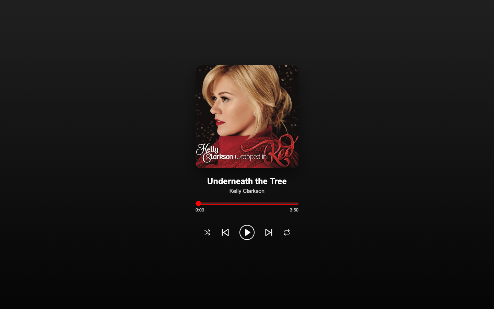
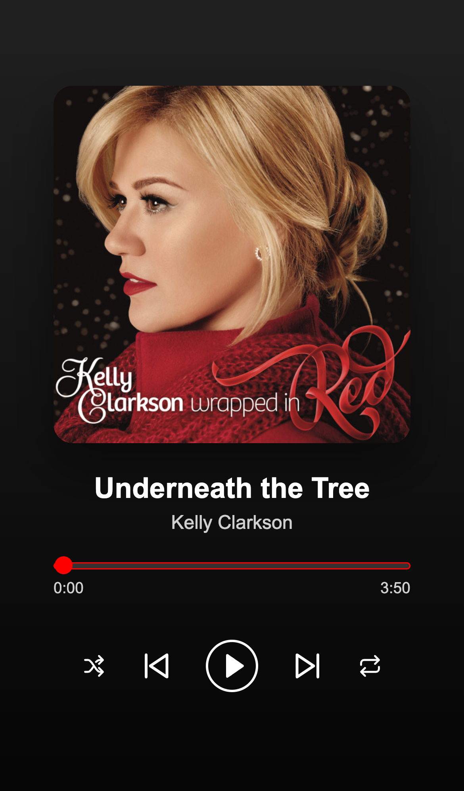

# Christmas Music Player

A Christmas playlist player built with **HTML, CSS, and vanilla JavaScript**. It includes play/pause, track navigation, shuffle with playback history, repeat, and a seekable timeline with a candy-cane progress effect.

This frontend portfolio project demonstrates how browser media events, application state, and an accessible interface work together without a framework or a backend.



<details>
<summary>View the mobile layout</summary>



</details>

## A quick walkthrough for reviewers

After starting the project locally, try this short tour:

1. **Press Play, then Pause.** The icon follows the audio element's actual state, and elapsed time updates during playback.
2. **Seek through a track.** Drag the red timeline or focus it and use the arrow keys. The elapsed time and striped progress update together.
3. **Use Next and Previous.** The title, artist, artwork, and duration change together. Navigation wraps at either end of the five-track playlist and preserves whether playback was running or paused.
4. **Enable Shuffle.** Next selects a different track; Previous retraces the tracks visited while shuffle was enabled. The green indicator and pressed state show the active mode.
5. **Enable Repeat track.** Seek near the end to hear the current song restart. Turn repeat off to advance automatically when the song finishes.
6. **Try a narrow screen and a keyboard.** The artwork and timeline fit a 320px viewport. Tab through the controls, use Enter or Space on buttons, and look for the visible focus outline.

## Features and frontend skills

| Area | Implementation |
| --- | --- |
| Browser media | A single `HTMLAudioElement`, metadata loading, play/pause events, seeking, and end-of-track handling. |
| State management | Current track, shuffle/repeat flags, and a history stack maintained in plain JavaScript. |
| Async behavior | Rejected play requests produce a visible message; request counters ignore failures from tracks the user has already left. |
| Data-driven rendering | One playlist array supplies each track's title, artist, artwork, and audio path. |
| Responsive CSS | Flexbox, fluid artwork/timeline widths, small viewport units, and scrolling on short screens. |
| Accessibility | Native buttons and range input, descriptive image text, toggle states, time announcements, visible focus, and a live status region. |
| Visual details | Dark gradient, rounded artwork, custom SVG controls, and layered CSS gradients for playback progress. |
| Testing | Playwright regression scenarios in desktop and mobile Chromium, plus GitHub Actions checks. |

## Run locally

Use **Node.js 22 or newer** with npm.

```sh
git clone https://github.com/JustineVizco25/music-player.git
cd music-player
npm ci
npm start
```

Open **http://127.0.0.1:4173**. Press Play to start listening; the player does not autoplay on page load.

The app needs no API keys, environment variables, build step, or runtime packages. Audio, artwork, and icons are local. npm installs development tools for the local server and browser tests.

The local server supports HTTP byte-range requests, which browsers use to seek through MP3 files. Use a static host with the same support when deploying.

## Test the project

Install Playwright's Chromium browser once:

```sh
npx playwright install chromium
npm run check
npm test
```

| Command | Purpose |
| --- | --- |
| `npm start` | Serve the project locally on port 4173. |
| `npm run check` | Check the player script's JavaScript syntax. |
| `npm test` | Run the browser suite; start the local server automatically if needed. |

The suite contains **14 scenarios run in two viewport configurations (28 checks)**. It covers real MP3 metadata and playback, paused seeking, all five tracks, navigation wraparound, playback continuity, shuffle history, repeat, automatic advancement, timeline reset during delayed loading, missing media, rejected/stale play requests, keyboard controls, and narrow/short layouts. Unexpected browser script errors fail the scenarios.

Desktop and mobile projects both use Chromium; the mobile configuration emulates an iPhone viewport and touch settings. It is not a Safari or physical-device test. Playback is muted during automated checks.

To use an installed Chrome instead of downloading Chromium, set `PLAYWRIGHT_CHROME_PATH` to the browser executable. For example, on macOS:

```sh
PLAYWRIGHT_CHROME_PATH="/Applications/Google Chrome.app/Contents/MacOS/Google Chrome" npm test
```

Failure screenshots and traces are saved to `test-results/` and excluded from Git. GitHub Actions installs Chromium and runs the syntax check and browser suite on pushes to `main` and pull requests.

## Code tour

```text
music-player/
├── index.html                 # Semantic player, SVG controls, and audio element
├── music-player.css           # Layout, responsive styles, controls, and focus states
├── music-player.js            # Playlist, media events, navigation, and progress rendering
├── mp3-files/                 # Five local audio tracks
├── song-images/               # Matching cover artwork
├── tests/player.spec.js       # Browser journeys and failure regressions
├── playwright.config.js       # Desktop/mobile test configuration and local server
├── docs/screenshots/          # Project previews for this README
├── .github/workflows/ci.yml   # Automated frontend checks
└── package.json               # Development commands and dependencies
```

For a focused code review, start with these functions in [`music-player.js`](music-player.js):

- **`updateSong()`** coordinates the metadata, artwork, timeline reset, and previous playback state when changing tracks.
- **`playSong()` and `syncPlayButton()`** handle asynchronous playback and keep the control label and icon aligned with media events.
- **`goToNextSong()`** selects the next sequential or shuffled track; the Previous handler uses the history stack.
- **`moveSlider()` and `updateSliderProgress()`** synchronize the media position, readable time, accessible range value, and layered progress gradients.

[`tests/player.spec.js`](tests/player.spec.js) demonstrates both normal user journeys and controlled failures, including a missing MP3 and a rejected browser play request.

## Design decisions

**A single audio element keeps playback coordinated.** Each track change updates its source. Playback state is read from the element rather than from a separate boolean that can drift out of sync.

**Shuffle remembers the actual path.** Next chooses among all tracks except the current one, and Previous pops the last visited track from a stack. Switching shuffle off clears that history. This is random selection, so an earlier track can appear again; it is not a full shuffled queue.

**The interface resets before metadata arrives.** The timeline is disabled and the times return to zero during a track change. It becomes seekable only when a finite duration is available.

**The app stays small.** HTML, CSS, and JavaScript remain separate files. Inline SVG controls avoid an icon CDN dependency. Development dependencies support testing and serving; the player itself runs directly in the browser.

## Scope and next steps

This is a frontend learning and portfolio project with a fixed Christmas playlist. It has no accounts, backend, streaming service integration, volume control, or saved session state. Reloading resets the selected track and playback modes. Repeat applies to the current track; automatic navigation wraps through the playlist.

Potential extensions include volume/mute controls, a visible playlist, persisted preferences, and Firefox/WebKit testing. These are ideas for future work, not current features.

The recordings and cover artwork belong to their respective rights holders. This repository does not grant a license to those media assets.

---

Maintained by [JustineVizco25](https://github.com/JustineVizco25).
